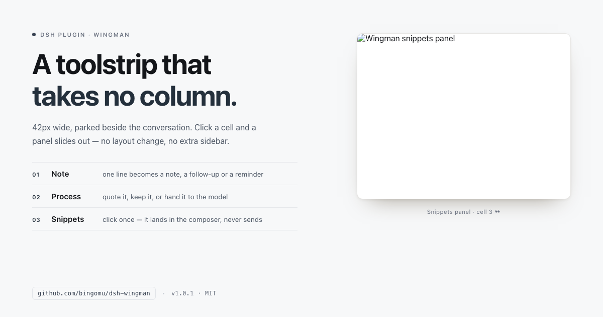
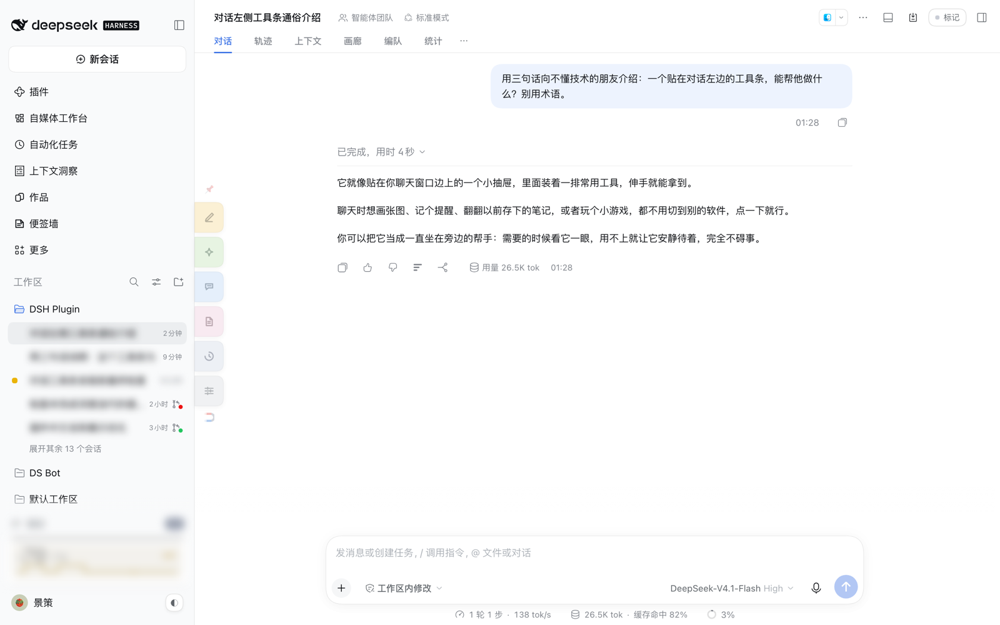
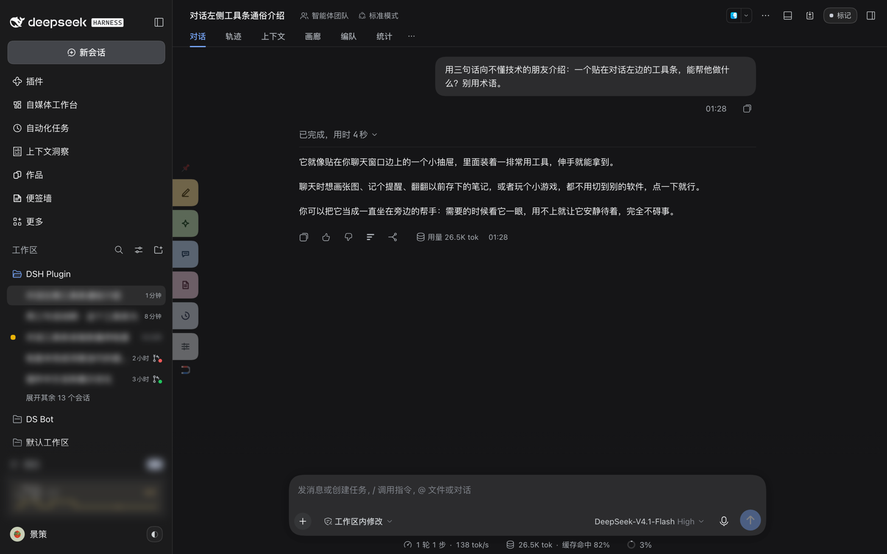
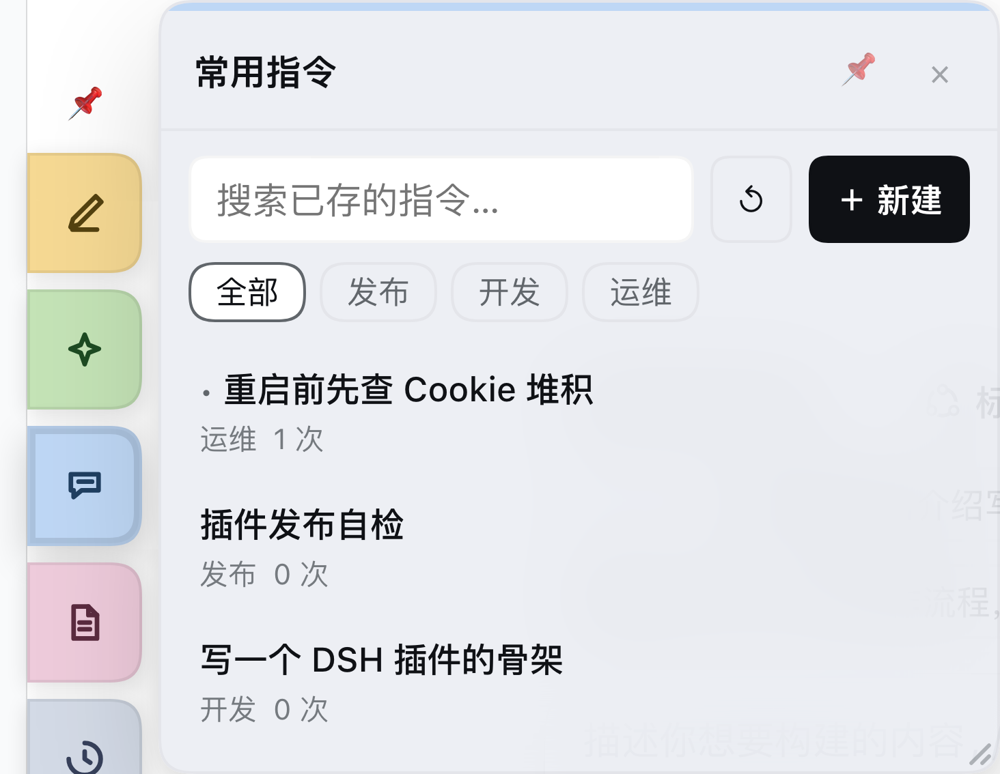
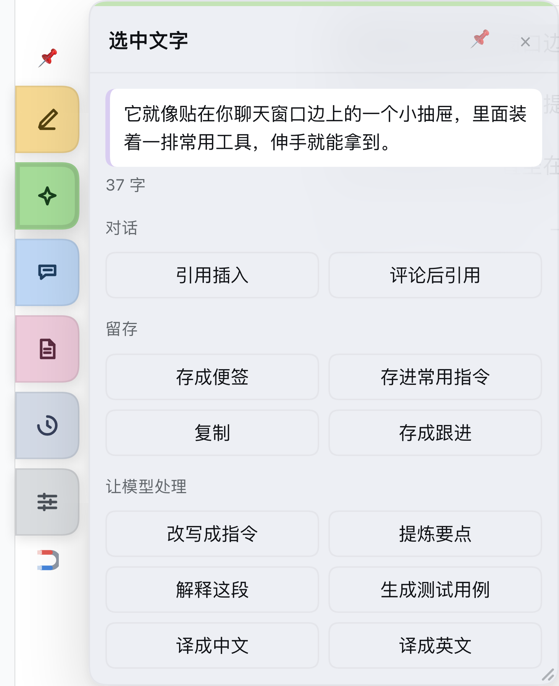
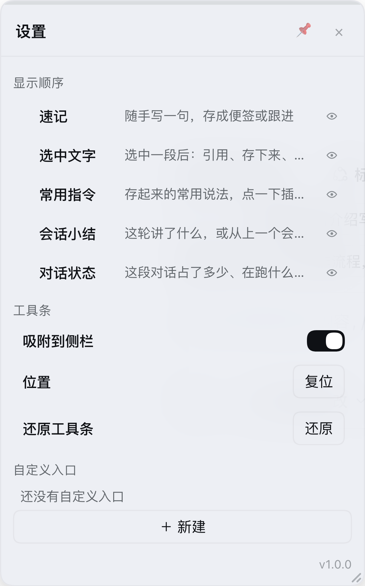
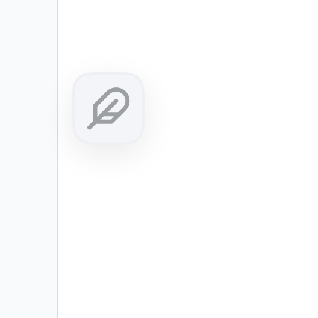
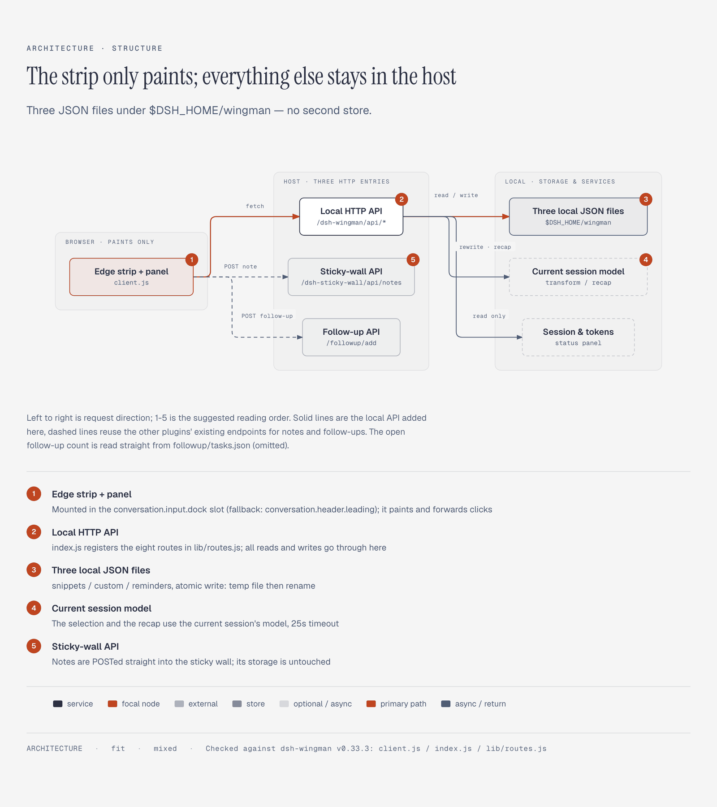

# Wingman



**Wingman: a tool strip that lives beside the conversation.** A 42px strip stays docked; click it and a panel slides out. It changes no layout, takes no left column, steals no right column — below 1100px wide it moves above the composer and takes about 42px of height. The first blade is Note: jot something down without leaving the conversation — a sticky note, a follow-up, or a reminder.

> Status: **v1.0.1**. Five built-in blades — Note / Process / Snippets / Summary / Status — plus custom entries and a settings gear.

[中文](README.md) · English

## Where it sits



**Right here**: the 42px strip between the sidebar and the conversation. Default light theme, stock DSH look — it takes no width from the body and changes no layout.



The same place in the dark theme — the strip follows the host theme, no extra skin needed.

## Close-ups



Snippets: search, groups and three built-in samples inside a 308px panel; click one to drop it into the composer (**nothing is sent**), and the panel closes itself.



With text selected you can quote it, save it as a sticky note or snippet, copy it, or hand it to the model to rewrite, summarise or translate.



Settings holds display order, hidden entries, the snap switch, position reset and custom entries.



Collapsed, it is just a feather; click it to bring the strip back, or drag it somewhere else.

**Colour = real entries.** Every blade carries a `tone` in its definition, and the strip renders the "live" list one by one.

The preset entry colours: Note=amber, Process=sage, Snippets=blue, Summary=rose, Status=slate; custom entries=lavender; the settings gear is neutral grey and takes no colour.

## How it fits together



- **Browser half (`client.js`)**: the edge strip and panel, mounted on the host's conversation slots; it owns rendering and interaction.
- **Host half (`index.js` + `lib/routes.js`)**: registers eight local HTTP routes at `/dsh-wingman/api/{snippets,custom,run,reminders,tail,recap,transform,watch}`.
- **Local storage**: `$DSH_HOME/wingman/{snippets,custom,reminders}.json`, written atomically; these three files are read and written locally only, never over the network. The Process AI actions and Summary run through the host model (see the last point below).
- **Reusing other plugins**: notes go through `/dsh-sticky-wall/api/notes` and follow-ups through `/followup/add`; no second store is created.
- **Using host services**: the Process AI actions and Summary call the current conversation's model; Status reads session and token data.

## What it can do

| Action | Result |
|---|---|
| Click ✎ | Open Note: sticky note / follow-up / reminder |
| Click ✦ | Open Process: quote it, save it, or hand it to the model |
| Click ❝ | Open/close the Snippets panel |
| Click ≡ | Open Summary: recap this thread, or pick up the last conversation |
| Click ◔ | Open Status: context ring, this round's tokens, subagents, open follow-ups |
| Click a snippet | Insert it into the composer; the caret ends after it |
| ＋ New | Title / group / body, saved to local JSON |
| ✎ (in a row) | Edit; × deletes |
| Search box | Filter by title, body or group as you type |
| Click 📌 (top right of the panel) | Pin the panel so clicking outside no longer closes it |
| Click × (bottom of the strip) | Collapse the whole strip down to a feather icon; click the icon to bring it back |
| Drag the feather | Drag it while collapsed; release near the sidebar to snap, and the position is remembered |

## Shortcuts and gestures

| Action | Result |
|---|---|
| ⌘1–⌘5 / Ctrl+1–5 | Open the first five blades in your saved order (inactive while the strip is collapsed) |
| Esc | Close |
| Drag the top grip | Move the strip; the position is remembered. Release within 56px of the sidebar's right edge to **snap** |
| Click the magnet (bottom) | Snap / unsnap in one click; while snapped it follows sidebar collapse and window resizes |
| Drag a few pixels sideways while snapped | Nudge the snap offset (±140px), used from then on |
| Window ≤ 1100px | The strip becomes one row above the composer (about 42px tall, covering no control; collapsing is not offered there) and the panel becomes a bottom drawer |

## What the Status panel shows

Click the grey ◔ for a read-only screen:

- **Context ring**: this round's request total / the model window; turns amber past 75% and red past 90%
- **This round's tokens**: input, output, cache read
- **Model**: provider · model
- **Subagents**: how many are running in this conversation
- **Follow-ups**: the open count (reads `DSH_HOME/followup/tasks.json`, read-only)

Nothing is requested until the panel is open; a value that cannot be measured shows `—`, and the screen never goes blank.

## What Summary is

Click ≡ for two buttons:

- **This thread**: the current conversation's model reads back over the last dozen or so messages and returns 3 conclusions / 2 open questions / 1 next step
- **Last conversation**: picks up the last conversation that had content with one opening line

The result can be regenerated or inserted into the composer (**nothing is sent**).

## Where Note goes

Click the amber ✎; the panel has three modes — sticky note / follow-up / reminder:

- **Sticky note**: type a line, press Enter → `POST /dsh-sticky-wall/api/notes` lands on the sticky wall (amber paper); the composer clears and the last three notes appear below
- **Follow-up**: type a line plus an optional "tomorrow / Friday / in 3 days"; Enter → `POST /followup/add`, with `due` parsed by the follow-up plugin; the current conversation id is attached so you can jump back
- **Reminder**: type a line and pick a time (the "in 1 hour / tonight 20:00 / tomorrow 10:00" quick buttons, or choose your own); the strip pops a notice when it is due
- A status line underneath shows `N notes · N open follow-ups`, plus the last three notes / follow-ups
- Sticky notes and follow-ups reuse the two plugins' existing HTTP endpoints — no new store, no changes to their code; reminders are written to the local `reminders.json`

## How Process works

✦ is always on the strip; once you select text, opening it shows that text. Select a passage in the body (at least 3 characters), click ✦, and the panel has three sections:

- **Conversation**: quote into the composer / quote after a comment
- **Keep**: save as a sticky note (sky-blue paper, category `摘录`, ending with `—— 摘自对话`) / save as a snippet (group `摘录`) / save as a follow-up / copy
- **Hand to the model**: rewrite as an instruction, extract key points, explain this, generate test cases, translate to Chinese, translate to English

Model results can be inserted into the composer, copied, or saved as a snippet. It uses the current conversation's model, with a 25-second timeout and one automatic retry on transport errors.

Only body text counts as a selection — selections inside the composer, a textarea, or this plugin's own panel do not; with nothing selected, opening ✦ just says "select some text in the body first" (the ✦ itself never disappears or dims).

## Reminders

The third mode inside Note: type a line and pick a time; the strip pops a notice when it is due. The client polls `GET /dsh-wingman/api/reminders` every 30 seconds; each reminder is announced once, and completed reminders are kept until the 7th day after creation.

## Custom entries

Create them under Settings → Custom entries; two kinds of action:

| Kind | What you fill in | What clicking Run does |
|---|---|---|
| Open path | An absolute path to a folder or file | Opens it with the system default app |
| Run command | A command (with an optional working directory) | Runs it there with a 20-second timeout; the output shows in the panel |

Once created it appears on the strip as a new blade (lavender; the icon follows the kind — a folder for open path, a terminal for run command). Commands run locally and are never uploaded; **do not paste commands from sources you do not trust**.

## What's in Settings

Click the gear at the bottom:

- **Display order**: press and hold a row for 160ms, then drag it up or down once the dashed outline appears; release to save
- **Show / hide**: the eye on the right of each row; hidden blades disappear from the strip but stay in Settings
- **Strip**: the snap-to-sidebar switch, reset position, and **reset the strip** (order / hidden / position / snap / collapsed all back to defaults in one go)
- **Custom entries**: see above
- The footer is just the version number

## Install

Install from GitHub (DSH ≥ 0.2.1-rc.5 required). Package name: `@bingomu/dsh-wingman`:

```bash
dsh plugin add github:bingomu/dsh-wingman#v1.0.1
```

For local development you can also hand the plugin directory to the plugin manager:

```bash
# plugin_manager install_bundle, target = <this repo>/dsh-wingman
```

A local-directory install is a symlink, so changes to `client.js` hot-reload within seconds; a GitHub install is a real package, so it needs a new release and a reinstall. Hard-refresh the page after installing (Cmd/Ctrl+Shift+R).

## Data

- Everything lives in `$DSH_HOME/wingman/` (`~/.dsh/wingman/` when `DSH_HOME` is unset):
  - `snippets.json`: snippets
  - `custom.json`: custom entries
  - `reminders.json`: reminders
- The first launch writes three sample snippets (release self-check / DSH plugin skeleton / check Cookie build-up before restarting); delete them if you like
- Atomic writes: temp file + rename; a corrupt JSON file is never silently overwritten — reading reports an error and keeps the original
- Limits:
  - Snippets: 200 entries, 120-character title, 8000-character body, 40-character group
  - Custom entries: 30, 40-character name, 500-character path/command
  - Completed reminders are kept until the 7th day after creation

## Known limits

- `{光标}` is currently just removed, so the caret ends after the inserted content — real positioning has to wait for a finer insertion API from the host
- There are no agent tools yet (the model cannot read or write snippets directly)
- Status does not show the next scheduled task yet — the host's schedule service is not wired up
- Note's sticky-note / follow-up modes depend on the sticky wall and follow-up HTTP endpoints; when they are absent you get a message and nothing is silently lost
- The Process AI actions spend one model call each; selections across pages or windows are not handled
- Copying depends on system clipboard permission; failures are reported
- Snapping is measured geometrically: it finds the sidebar column against the left edge of the window and takes its right edge, falls back to the body column's left edge when the sidebar is collapsed, then to layout variables; if nothing can be measured it stays put — it never throws the strip off-screen just because it could not measure
- Snapping is on by default; turn it off with the magnet if you prefer free dragging
- If the left column is collapsed when the strip first opens, the first measurement may need a resize or the 0.6s poll to line up

## Development

```bash
npm run check   # syntax check for 12 JS files + the static client.js self-check
npm test        # 8 test files, 35 cases
```

Design trade-offs live in [docs/01-design.md](docs/01-design.md), the plan in [ROADMAP.md](ROADMAP.md), and changes in [CHANGELOG.md](CHANGELOG.md).
