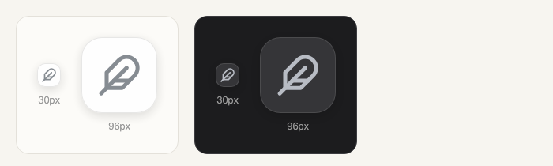

# Wingman

**Wingman：挂在对话旁边的工具条。** 42px 工具条常驻，点开滑出一张面板；不改变布局、不占左栏、不抢右栏。第一颗是「速记」：不离开对话，一句话记成便签、跟进或提醒。

> 状态：**v0.33.3**。内置 5 颗：速记 / 选中文字 / 常用指令 / 会话小结 / 对话状态，外加自定义入口与设置齿轮。

## 它长什么样

```
⋮⋮           握把（拖动改位置，点 📌 让工具条常亮）
╭──────╮
│  ✎   │ 琥珀 · 速记
╰──────╯
╭──────╮
│  ✦   │ 浅绿 · 选中文字（一直在工具条上；没选中时点开只提示先选中一段）
╰──────╯
╭──────╮
│  ❝   │ 浅蓝 · 常用指令
╰──────╯
╭──────╮
│  ≡   │ 玫瑰 · 会话小结
╰──────╯
╭──────╮
│  ◔   │ 浅灰 · 对话状态
╰──────╯
╭──────╮
│  ⚙   │ 中性 · 设置（顺序 / 隐藏 / 吸附 / 位置 / 自定义入口）
╰──────╯
   🧲           吸附开关
```

**颜色 = 真实入口数。** 每颗便签在定义里带一个 `tone`，工具条按「已上线」列表逐个渲染。

已排好的入口色：速记=琥珀、选中文字=浅绿、常用指令=浅蓝、会话小结=玫瑰、对话状态=浅灰；自定义入口=淡紫；设置是中性灰，不占颜色。

点 ❝ 滑出 308px 面板：搜索、分组、常用指令列表。点任意一条 → 内容进输入框（**不发送**），面板自动收回。

## 现在能做什么

| 动作 | 结果 |
|---|---|
| 点 ✎ | 打开「速记」：便签 / 跟进 / 提醒三种模式 |
| 点 ✦ | 打开「选中文字」：引用、存下来，或交给模型 |
| 点 ❝ | 打开/收起常用指令面板 |
| 点 ≡ | 打开「会话小结」：总结这轮，或从上一个会话接一句开场 |
| 点 ◔ | 打开「对话状态」：上下文占用环、本轮 token、子代理、未完成跟进 |
| 点一条指令 | 插入当前输入框，光标停在末尾 |
| ＋ 新建 | 标题 / 分组 / 正文，保存到本机 JSON |
| ✎（行内） | 编辑；× 删除 |
| 搜索框 | 按标题、正文、分组即时过滤 |
| 点面板右上角 📌 | 钉住面板，点外面不收起 |
| 点 ×（工具条最下面） | 收起整条工具条，只剩一枚羽毛图标；点图标叫回来 |
| 拖羽毛 | 收起态也能拖着走；松手贴近侧栏自动吸附，位置记住 |

## 快捷键与手势

| 操作 | 结果 |
|---|---|
| ⌘1–⌘5 / Ctrl+1–5 | 按你调好的顺序打开前五颗便签（工具条收起时不生效） |
| Esc | 收起 |
| 拖顶部握把 | 移动工具条，位置记住；拖到离侧栏右缘 56px 内松手即**吸附** |
| 点磁铁（底部） | 一键吸附 / 取消吸附；吸附后跟随侧栏折叠与窗口缩放 |
| 吸附态横向拖几像素 | 微调吸附偏移（±140px），以后一直按这个偏移贴边 |
| 窗口 ≤ 1100px | 工具条变底部横排，面板变底部抽屉（左右各留 12px） |

收起后的样子（左：浅色 / 右：深色，右侧是放大）：



## 「对话状态」看什么

点浅灰的 ◔，一屏只读：

- **上下文环**：本轮请求总量 / 模型窗口，超过 75% 转黄、90% 转红
- **本轮 token**：输入、输出、缓存读
- **模型**：provider · model
- **子代理**：本会话正在跑的个数
- **跟进**：未完成条数（读 `DSH_HOME/followup/tasks.json`，只读）

不打开面板就不请求；数不出来的一项显示 `—`，不会整屏空掉。

## 「会话小结」是什么

点 ≡，面板里两个按钮：

- **这轮**：让当前会话的模型回头读最近十几条消息，输出 3 条结论 / 2 条未决 / 1 条下一步
- **上个会话**：从上一个有内容的会话接一句开场

结果可以「重新生成」或「插入输入框」（**不发送**）。

## 「速记」记到哪

点琥珀色的 ✎，上面是「便签 / 跟进 / 提醒」三个模式：

- **便签**：写一句，Enter → `POST /dsh-sticky-wall/api/notes`，落在便签墙（琥珀纸色）；输入框清空，下面出现最近 3 条
- **跟进**：写一句 + 可选「明天 / 周五 / 3天后」，Enter → `POST /followup/add`，due 由跟进插件解析；会自动带上当前会话 id，方便跳回
- **提醒**：写一句 + 选时间（「1 小时后 / 今晚 20:00 / 明天 10:00」快捷按钮，或自己挑），到点工具条弹一次提示
- 底部一行状态：`便签 N 张 · 跟进 N 条未完成`，以及最近便签 / 最近跟进各 3 条
- 便签与跟进复用两个插件已有的 HTTP 接口，不新建存储、不改它们的代码；提醒写本机 `reminders.json`

## 「选中文字」怎么用

✦ 一直在工具条上，选中后点开就是这段文字。在正文里选中一段（至少 3 个字），点 ✦，面板分三段：

- **对话**：引用到输入框 / 评论后引用
- **留存**：存成便签（天蓝纸、分类「摘录」，末尾带「—— 摘自对话」）/ 存进常用指令（分组「摘录」）/ 存成跟进 / 复制
- **交给模型**：改写成指令、提炼要点、解释这段、生成测试用例、译成中文、译成英文

模型结果可以插入输入框、复制、存进常用指令。用的是当前会话的模型，25 秒超时，传输类错误自动重试一次。

选区只认正文——落在输入框、文本域、本插件自己的面板里都不算；没选中时点开只提示「先在正文里选中一段文字」（✦ 本身不会消失，也不会变淡）。

## 定时提醒

「速记」里的第三种模式：写一句 + 选时间，到点工具条弹提示。客户端每 30 秒轮询一次 `GET /dsh-wingman/api/reminders`；同一条只提示一次，已完成的提醒保留到创建后第 7 天。

## 自定义入口

在「设置 → 自定义入口」里新建，两种动作：

| 类型 | 填什么 | 点执行后 |
|---|---|---|
| 打开路径 | 一个文件夹或文件的绝对路径 | 用系统默认方式打开 |
| 运行命令 | 一条命令（可填工作目录） | 在那里跑，20 秒超时，输出显示在面板里 |

建好后，它会作为一颗新便签出现在工具条上（淡紫；图标按类型画：打开路径是文件夹，运行命令是终端）。命令只在本机执行，不会上传；**别把不明来源的命令粘进来**。

## 「设置」里有什么

点最下面的齿轮：

- **显示顺序**：按住一行 160ms，出现虚线框后上下拖动换位；松手即存
- **显示 / 隐藏**：每行右侧的眼睛；隐藏的便签不出现在工具条上，但仍留在设置里
- **工具条**：吸附到侧栏开关、位置复位、**还原工具条**（顺序 / 隐藏 / 位置 / 吸附 / 收起一次回默认）
- **自定义入口**：见上
- 脚注只有版本号

## 安装

从 GitHub 装（需要 DSH ≥ 0.2.1-rc.5）：

```bash
dsh plugin add github:bingomu/dsh-wingman#v0.33.3
```

本机开发时也可以直接把插件目录交给插件管理器：

```bash
# plugin_manager install_bundle，target = <本仓库>/dsh-wingman
```

本地目录安装是软链接，改 `client.js` 后几秒内热更新；从 GitHub 装的是实体包，要重新发版 + 重装。装完硬刷新页面（Cmd/Ctrl+Shift+R）。

## 数据

- 都在 `$DSH_HOME/wingman/`（没有 `DSH_HOME` 时是 `~/.dsh/wingman/`）：
  - `snippets.json`：常用指令
  - `custom.json`：自定义入口
  - `reminders.json`：定时提醒
- 首次启动写入三条示例指令（插件发布自检 / 写一个 DSH 插件的骨架 / 重启前先查 Cookie 堆积），删掉即可
- 原子写：临时文件 + rename；坏 JSON 不会被静默覆盖，读取会报错并保留原文件
- 上限：
  - 常用指令 200 条、标题 120 字、正文 8000 字、分组 40 字
  - 自定义入口 30 个、名称 40 字、路径/命令 500 字
  - 已完成的提醒保留到创建后第 7 天

## 已知边界

- `{光标}` 目前只是被去掉，光标停在插入内容末尾——真正的定位要等宿主给更细的插入接口
- 还没有 agent 工具（模型不能直接读写常用指令）
- 「对话状态」里暂时没有「下次定时任务」——还没接宿主的 schedule 服务
- 「速记」的便签 / 跟进依赖便签墙与跟进的 HTTP 接口；它们不在时只显示提示，不会静默丢内容
- 「选中文字」的 AI 动作会用掉一次模型调用；跨页、跨窗口的选区不处理
- 复制依赖系统剪贴板权限，失败会给提示
- 吸附靠几何测量：先找贴着窗口左缘的侧栏列取右缘，侧栏收起时取正文列左缘，再退回布局变量；都测不到就保持原位——不会因为量不到而把工具条甩到屏幕外
- 吸附默认开；不喜欢点磁铁关掉，之后就是自由拖拽
- 工具条刚打开时如果左栏是收起状态，第一次测量可能要等一次缩放 / 0.6s 轮询才对齐

## 开发

```bash
npm run check   # 12 个 JS 文件的语法检查 + client.js 静态自检
npm test        # 8 个测试文件、33 个用例
```

设计取舍见 [docs/01-design.md](docs/01-design.md)，排期见 [ROADMAP.md](ROADMAP.md)，改动见 [CHANGELOG.md](CHANGELOG.md)。
